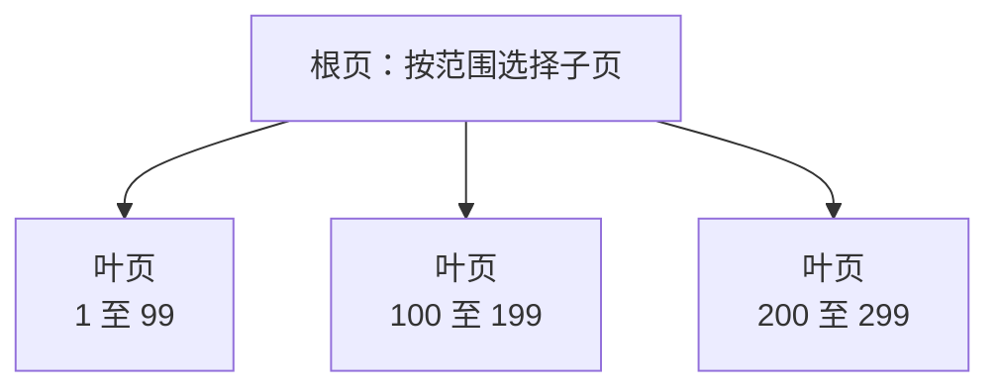

# Into the Woods: Finding Your Way with B-Trees in PostgreSQL

建了索引，查询仍然要排序；复合索引里明明有查询条件用到的列，却没有获得预期的加速。排查这类问题时，“有没有索引”往往还不够，还需要看索引把数据按什么顺序组织起来，以及查询能利用其中哪一段。

Sergey Dudoladov 在 PostgreSQL Conference Germany 2026 的《Into the Woods: Finding Your Way with B-Trees in PostgreSQL》中，从查找过程讲到 NULL、复合索引和向量检索。贯穿这些问题的是同一件事：B-tree 通过维护一个确定的顺序，减少查找时需要访问的数据；查询要求的顺序一旦变了，原来的捷径也可能失效。

## 为什么一棵很浅的树能查找大量数据

在一堆无序数字中找 42，通常要逐个检查。排好序后，可以不断排除不可能包含它的区间。数据库还要考虑另一个成本：数据按页读取，逐条比较的次数与需要访问的页面数，是两个不同的问题。

PostgreSQL 默认使用 8KB 页面。B-tree 的一个内部页可以容纳许多分隔键和子页指针，一次向下选择，就能排除大量数据。叶页保存索引键及定位表中行版本的信息，内部页负责指引查找方向。



查找 123 时，沿根页给出的范围进入中间的叶页。查找 123 到 220 时，先定位起点，再沿叶页继续扫描，直到超过上界。树更大时，根与叶之间还会有内部层，导航方式相同。

原分享展示过一个约 14GB、6.76 亿条索引条目的索引，树高只有四层。能容纳多少数据，取决于每页能放多少键、页面利用率和分裂情况；不是每增加一些记录，就需要增加一层。

这也解释了为什么“查到一条”与“取回很多条”的成本差别很大。定位叶页后，后续仍有索引范围扫描、行可见性判断和可能的回表访问。返回大量数据时，这些工作会超过最初几层导航的成本。

索引中的相邻条目，指向的表记录也未必在相邻堆页上。B-tree 维护的是索引顺序，不会随每次插入把整张表重新排好。规划器选择顺序扫描时，也可能是在避免大量分散的回表读取。

## NULL 的位置也是索引顺序的一部分

SQL 中，`NULL < 42` 的结果是 unknown。但索引仍需为 NULL 安排一个位置，才能形成可遍历的顺序。默认的 B-tree 顺序是 `ASC NULLS LAST`，反向扫描则得到 `DESC NULLS FIRST`。

下面用一组确定的数据比较排序方式：30 万行，`x` 有十个取值，`y` 递增，`score` 中五分之一是 NULL。两个索引分别用于观察单列排序和复合键查找。

<!-- verify:setup -->
```sql
CREATE SCHEMA btree_demo;
CREATE TABLE btree_demo.items (x integer, y integer, score integer);
INSERT INTO btree_demo.items
SELECT g % 10, g,
       CASE WHEN g % 5 = 0 THEN NULL ELSE g % 1000 END
FROM generate_series(1, 300000) AS g;
CREATE INDEX items_score ON btree_demo.items (score ASC NULLS LAST);
CREATE INDEX items_xy ON btree_demo.items (x, y);
VACUUM (ANALYZE) btree_demo.items;
SET max_parallel_workers_per_gather = 0;
```

按索引已有顺序取前十行：

<!-- verify:nulls-last -->
```sql
EXPLAIN (ANALYZE, COSTS OFF, TIMING OFF, SUMMARY OFF, BUFFERS OFF)
SELECT score FROM btree_demo.items
ORDER BY score ASC NULLS LAST LIMIT 10;
```

<!-- result:nulls-last -->
```text
Limit (actual rows=10.00 loops=1)
  ->  Index Only Scan using items_score on items (actual rows=10.00 loops=1)
        Heap Fetches: 0
        Index Searches: 1
```

把 NULL 改为排在前面，但仍要求非空值升序：

<!-- verify:nulls-first -->
```sql
EXPLAIN (ANALYZE, COSTS OFF, TIMING OFF, SUMMARY OFF, BUFFERS OFF)
SELECT score FROM btree_demo.items
ORDER BY score ASC NULLS FIRST LIMIT 10;
```

<!-- result:nulls-first -->
```text
Limit (actual rows=10.00 loops=1)
  ->  Sort (actual rows=10.00 loops=1)
        Sort Key: score NULLS FIRST
        Sort Method: top-N heapsort  Memory: 25kB
        ->  Seq Scan on items (actual rows=300000.00 loops=1)
```

前一条可以从索引起点直接取十行，后一条需要重新排序。top-N heapsort 只保留少量候选结果，但上游仍要交出全部候选行，才能决定最前面的十行。`LIMIT 10` 限制的是输出，并没有让这次排序只检查十行。

反向扫描也不能任意重排 NULL。把同一个索引倒着读，会同时倒转非空值顺序与 NULL 的位置：

<!-- verify:backward -->
```sql
EXPLAIN (ANALYZE, COSTS OFF, TIMING OFF, SUMMARY OFF, BUFFERS OFF)
SELECT score FROM btree_demo.items
ORDER BY score DESC NULLS FIRST LIMIT 10;
```

这条查询可直接使用反向索引扫描。如果业务经常要求 `ASC NULLS FIRST`，则可以按这个顺序建立索引；单列场景中，它也能反向提供 `DESC NULLS LAST`。

这里出现的 Index Only Scan，是因为查询所需数据都在索引中；`VACUUM` 又让相应堆页具备了 all-visible 标记，扫描可以通过可见性映射确认记录可见，因而得到 `Heap Fetches: 0`。频繁更新的表上，这个数字可能增加，原因要从可见性状态判断。

## 复合索引把多列排成一条序列

`(x, y)` 索引先比较 `x`，只有 `x` 相同时才比较 `y`。用少量键表示，就是：

```text
(0, 10) (0, 20) (0, 30) ...
(1,  1) (1, 11) (1, 21) ...
(2,  2) (2, 12) (2, 22) ...
```

每个 `x` 分组内部的 `y` 有序，整个索引却没有按 `y` 全局排序。于是下面这条查询很适合 `(x, y)`：

<!-- verify:prefix -->
```sql
EXPLAIN (ANALYZE, COSTS OFF, TIMING OFF, SUMMARY OFF, BUFFERS OFF)
SELECT x, y FROM btree_demo.items
WHERE x = 3 ORDER BY y LIMIT 10;
```

`x = 3` 把扫描限定在一个连续分组内，组内恰好按 `y` 排序，取得十行就可以结束。若去掉 `x = 3`，只保留 `ORDER BY y`，各分组仍要重新组织成全局的 `y` 顺序。

同理，索引 `(x ASC, y ASC)` 整体反向扫描，会得到 `(x DESC, y DESC)`。需要 `x ASC, y DESC` 时，应考虑相应的混合方向索引。判断能否免排序，要把列顺序、方向和 NULL 位置一起看。

对于过滤条件，关键是它能缩小多大一段扫描区间。前导列上的等值条件，加上随后第一个非等值列的范围条件，通常能确定扫描的边界。更靠后的条件仍可以在索引中检查，减少回表，但未必同样缩小需要遍历的索引范围。

## PG18 skip scan 怎样利用后面的列

只给 `y` 条件时，同一个目标可能位于任意 `x` 分组。PG18 的 skip scan 可以在前导列缺少等值条件时，内部生成相应的等值约束，分组重新定位。

对这张表，可以把查找过程理解为依次寻找 `(0, 123453)`、`(1, 123453)`，直到遍历相关的 `x` 分组。每次搜索都能借助树定位，跳过组内大量无关的叶页。SQL 本身仍然只写 `y` 条件：

<!-- verify:skip -->
```sql
EXPLAIN (ANALYZE, COSTS OFF, TIMING OFF, SUMMARY OFF, BUFFERS OFF)
SELECT x, y FROM btree_demo.items WHERE y = 123453;
```

<!-- result:skip -->
```text
Index Only Scan using items_xy on items (actual rows=1.00 loops=1)
  Index Cond: (y = 123453)
  Heap Fetches: 0
  Index Searches: 12
```

它仍显示为 Index Only Scan，而非一个单独名为 Skip Scan 的节点。`Index Searches` 展示扫描中发生了多次索引搜索；结合这里只约束第二列、第一列只有十种取值的条件，就能看懂这些重复搜索的用途。这个计数也用于其他多次搜索场景，查看计划时需要结合查询条件。

原分享用相同的五百万行例子对比过版本：PG17.9 选择顺序扫描，PG18 利用 skip scan 改用索引。前导列取值较少时，重复定位的开销容易控制；若有几十万种取值，逐组搜索的成本就很高，规划器会重新比较整段索引扫描和顺序扫描等方案。

因此，设计索引时仍要看主要查询。经常只查 `y` 的业务，值得比较独立的 `(y)` 索引；主要查询是 `x = ? ORDER BY y LIMIT ?` 时，`(x, y)` 则同时提供定位和组内顺序。skip scan 增加了复用已有索引的机会，前导列基数与访问频率仍然决定哪种设计更合适。

## 按键值有序，为什么还不能直接找最近的向量

把二维坐标存成 `(x, y)`，可以按字典序排好，却无法据此直接得到“离查询点最近”的顺序。

例如，查询点是 `(0.50, 0.50)`。点 A 为 `(0.50, 100)`，点 B 为 `(0.51, 0.50)`。按第一列比较，A 与查询点的 `x` 完全相同；按欧氏距离，A 距离 99.5，B 却只有 0.01。只围绕第一列接近的位置搜索，会漏掉空间中真正接近的点。

原分享用 pgvector 演示了这个区别：给 `embedding` 建普通 B-tree 后，按 `embedding <-> 查询向量` 排序，仍需要计算距离并做 top-N 排序。向量值可比较的顺序，与相对某个查询向量的距离顺序，是两个不同的顺序；后者还会随查询点改变。

pgvector 的 HNSW 使用多层邻近图来搜索距离较近的候选，支持相应距离运算的索引扫描。它采用近似最近邻搜索，参数选择需要兼顾速度和召回率。这里选索引的依据，是查询要求的距离关系，而非单看数据类型能否建立 B-tree。

## 看计划时，追踪索引省掉了哪些工作

有些索引只减少过滤，有些同时省掉排序，有些还能让 `LIMIT` 提前结束。排查时，可以把 SQL 中的过滤范围、返回顺序和返回数量，对照索引的键顺序逐项判断。

如果计划多了 Sort，检查方向和 NULL 位置是否匹配；复合索引读取很多条目却返回很少结果，检查条件究竟缩小了扫描范围，还是仅在扫描途中排除条目；出现多次 Index Searches，结合前导列基数和条件判断重复定位是否合算。

树高解释了定位起点为何便宜。真正决定一条查询后续成本的，还包括扫过多少叶页、访问多少堆页，以及能否按需要的顺序尽早结束。理解这几件事，比记住“某种条件会走索引”更适合用来判断索引设计。

索引的写入与维护成本，可继续阅读 [过度索引](/docs/18.md)；涉及字符串顺序时，参见 [排序规则与索引](/docs/103.md)；分析计划选择可结合 [优化器提示](/docs/110.md)。

## 参考资料

- Sergey Dudoladov：[Into the Woods: Finding Your Way with B-Trees in PostgreSQL](https://www.postgresql.eu/events/pgconfde2026/schedule/session/7600-into-the-woods-finding-your-way-with-b-trees-in-postgresql/)，PostgreSQL Conference Germany 2026，2026-04-22。
- PostgreSQL 18：[B-tree 结构与实现](https://www.postgresql.org/docs/18/btree.html)、[索引与 ORDER BY](https://www.postgresql.org/docs/18/indexes-ordering.html)、[复合索引与 skip scan](https://www.postgresql.org/docs/18/indexes-multicolumn.html)。
- PostgreSQL 18：[Index-Only Scan](https://www.postgresql.org/docs/18/indexes-index-only-scans.html)、[pageinspect](https://www.postgresql.org/docs/18/pageinspect.html)。
- pgvector：[索引与 HNSW](https://github.com/pgvector/pgvector#hnsw)。

中文解读与技术校订：xiongcc。
