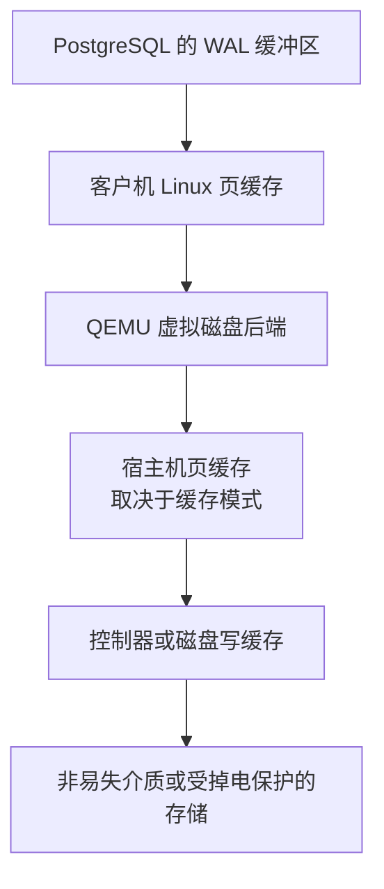

# Caching in the Storage Path: How to Gain Performance Without Loosing Data

把虚拟机磁盘改成另一种缓存模式，事务提交突然快了很多。数据照样能查到，重启数据库也正常，这个优化可以放心上线吗？

需要弄清楚的是：提交成功时，WAL 到了哪里；宿主机突然断电后，这份 WAL 还在不在。

Werner Fischer 在《Caching in the Storage Path》中，沿 Linux 页缓存、设备缓存和 QEMU 虚拟磁盘逐层讨论了这个问题。这份 Open Source Summit / Embedded Linux Conference Europe 分享还使用断电测试，检查存储系统是否兑现了刷盘成功的承诺。放到 PostgreSQL 场景，理解这条路径，才能判断一次性能提升省去了什么工作。

## COMMIT 等待的是 WAL 的持久化

以启用 `fsync`、使用 `synchronous_commit=on` 的普通持久表事务为例。修改表时，PostgreSQL 会在共享缓冲区中修改数据页，同时生成用于恢复的 WAL。提交阶段需要确保截至该事务提交记录的 WAL 已完成本地持久化；配置同步复制时，还可能需要等待备库。

表和索引的数据页可以在后台写出。崩溃后，数据库利用持久化的 WAL 重做尚未体现在数据文件中的修改，因此每次提交无需把这个事务涉及的所有数据页都同步落盘。数据页写出之前，对应的 WAL 也必须先完成持久化，这就是预写日志的顺序要求。

不过，“写 WAL”与“WAL 已持久化”之间，还隔着数据库外部的缓存。

在使用缓冲 I/O、以本地磁盘镜像承载虚拟磁盘的典型 Linux 虚拟机中，WAL 的写入可能经过下面这些位置：

不同后端可能绕过其中一些位置，例如直接访问块设备，或把写入交给远端存储。每经过一层，都要区分两种确认：普通写入请求已被接收，以及要求持久化的请求已经完成。

普通 `write()` 返回成功，往往只说明数据进入了内核页缓存。PostgreSQL 通过 `wal_sync_method` 所选的同步机制，例如 `fdatasync()`、`fsync()` 或同步打开文件的方式，要求下面各层完成必要的持久化。操作系统、虚拟化层和设备都正确实现这个要求，提交成功才具有预期的掉电安全性。

假设 QEMU 把刷盘请求直接当作成功处理，WAL 仍留在宿主机内存中。此时客户机和 PostgreSQL 都可能已经收到成功，宿主机断电却会丢掉这份 WAL。数据库内部的设置无法补回没有传递下去的持久化请求。

## 页缓存为什么能加速，又为什么会带来停顿

Linux 页缓存把文件的一部分内容保留在内存中。读请求命中缓存后，可以省去一次存储访问；写请求先修改缓存页，内核再把脏页写回存储。多次修改同一页有机会合并，回写也可以分批进行。

这种缓冲能吸收短时间的写入突发，但空间有限。如果应用生成脏数据的速度持续高于存储写出速度，积压最终会迫使写入进程等待。

原材料介绍了四个相关参数：

| 参数 | 影响的行为 |
| --- | --- |
| `vm.dirty_background_ratio` | 脏页达到相应比例时，触发后台回写 |
| `vm.dirty_ratio` | 脏页达到更高阈值时，写入进程可能被节流或参与回写 |
| `vm.dirty_expire_centisecs` | 脏页积累多久后，进入周期回写的候选范围 |
| `vm.dirty_writeback_centisecs` | 周期回写线程的唤醒间隔 |

两个比例针对内核用于计算脏页限制的可用内存范围，不能直接拿机器总内存相乘。原材料中的 10% 和 20% 是示例，实际配置还可能使用对应的 `dirty_background_bytes`、`dirty_bytes` 字节阈值。

这里的回写周期也不是事务持久化的倒计时。即使脏页还没到后台阈值，应用发出的同步请求仍需得到处理；把回写间隔设得更短，也不能替代事务提交需要的同步。

对 PostgreSQL 来说，数据文件后台回写与 WAL 同步会争用存储资源。如果提交延迟在大量数据页写出时上升，需要对照 WAL 同步耗时、检查点写出情况和设备延迟，判断是否存在竞争。单纯放大脏页阈值可以延后等待，也可能把更多工作积压到后面。

## 磁盘报告写入完成，数据可能还在设备缓存里

数据离开操作系统内存后，还可能进入 RAID 控制器或磁盘内部的写缓存。设备可以先接收请求、报告普通写入完成，再选择合适的时机写入磁介质或闪存。

如果这块缓存是易失的，断电就可能丢失内容。操作系统需要使用设备提供的持久化机制，才能把应用的同步要求继续传下去。

另一种做法是让缓存本身具备掉电保护。原材料展示的数据中心 SSD 使用电容，在掉电时提供足够能量，把受保护的数据和必要状态保存到非易失介质。某些硬盘也提供类似的持久写缓存机制。带电池或其他保护机制的 RAID 缓存，则能在规定条件下保留尚未写入磁盘的内容。

判断设备能保护什么，要看具体型号的承诺：是否保护已确认的用户写入、内部映射信息，以及保护机制的健康状态。“企业级”或“有电容”这样的标签，不能代替这些信息。

保护范围同样重要。SSD 的电容能够保护设备内部的数据，仍在宿主机页缓存里的 WAL 不在它的覆盖范围内。控制器缓存受保护，也需要继续检查后端磁盘的确认行为。可靠性要沿实际路径逐层确认。

## FLUSH 和 FUA 怎样约束设备的写入

存储设备为了吞吐量，可以合并和重排普通请求。文件系统却存在需要保持的持久化顺序，例如日志中的相关内容必须先安全保存，之后才能认为对应的日志提交已经完成。

Linux 块层提供了两种关键机制：

| 机制 | 完成条件 |
| --- | --- |
| FLUSH / `REQ_PREFLUSH` | 把设备易失缓存中此前已完成的写入推进到非易失存储，再开始相应的后续请求 |
| FUA / `REQ_FUA` | 当前写请求的数据到达非易失存储后，才报告该请求完成 |

例如，文件系统可以要求先同步此前的日志内容，再用具有 FUA 语义的写请求保存提交记录。设备掉电后，不能只剩下一个已持久化的提交标记，却缺少它所依赖的日志内容。具体请求组合由文件系统和块层实现；设备不原生支持 FUA 时，块层还可以通过后续 flush 等方式实现相应语义。

“写屏障”讨论的就是这类顺序和持久化约束。它与 CPU 用于内存访问排序的屏障是不同层面的问题，也不要求把所有普通磁盘写入都串行化。

关闭这些约束后，压测可能更快，因为原来需要等待设备确认的工作减少了。只有整条相关路径确实具备所需的持久化和顺序保证，才有讨论省去这些请求的基础；仅凭一块带掉电保护的 SSD，不足以决定关闭文件系统写屏障。

## QEMU 的五种缓存模式，实际控制三个问题

原材料最实用的一部分，是把虚拟磁盘缓存拆成三个独立的设置：

- `cache.writeback`：虚拟设备是否向客户机暴露写回缓存属性。客户机据此决定何时需要显式同步设备缓存。
- `cache.direct`：QEMU 是否绕过宿主机页缓存。
- `cache.no-flush`：QEMU 是否忽略刷盘请求。

传统 `cache=` 名称是这些设置的组合：

| QEMU 模式 | `writeback` | `direct` | `no-flush` | 对写入路径的主要影响 |
| --- | --- | --- | --- | --- |
| `writeback` | 开 | 关 | 关 | 使用宿主机页缓存，处理客户机刷盘请求 |
| `none` | 开 | 开 | 关 | 绕过宿主机页缓存，仍处理刷盘请求 |
| `writethrough` | 关 | 关 | 关 | 使用宿主机页缓存，按同步写入语义完成请求 |
| `directsync` | 关 | 开 | 关 | 绕过宿主机页缓存，按同步写入语义完成请求 |
| `unsafe` | 开 | 关 | 开 | 使用宿主机页缓存，忽略刷盘请求 |

`none` 在 Proxmox 界面中通常叫作 “No cache”。它绕过的是宿主机页缓存，客户机页缓存和物理设备缓存仍可能存在。它向客户机暴露的仍是写回缓存属性，因此客户机依然需要在适当时机发出刷盘请求。

`writeback` 允许普通写请求在数据进入宿主机页缓存后就完成；客户机要求刷盘时，QEMU 再执行相应的同步。只要客户机正确发起同步、后端存储正确处理请求，这种方式可以满足持久化要求。缓冲普通写入与兑现刷盘请求，可以同时成立。

`unsafe` 则省掉了后一个要求。即使 PostgreSQL 保持 `fsync=on`，客户机文件系统也发送了刷盘请求，QEMU 仍可直接报告完成。事务延迟变低，很可能来自这段等待被取消。

`writethrough` 和 `directsync` 让每次写请求承担更强的同步要求，通常会增加写入等待。其具体实现可以使用同步 I/O 标志等方式，不必理解成每次都单独调用一次 `fsync()`。同样，`direct` 只控制宿主机页缓存的绕过，本身不提供掉电持久化承诺。

选择模式时，需要同时考虑缓存是否重复、内存占用、实际负载和存储后端。五种名称并不是一条从快到慢、从危险到安全的固定排行榜；其中 `unsafe` 忽略同步请求这一点，则直接改变了数据库获得的保证。

## 断电测试检查的是哪一份承诺

Werner 使用 `diskchecker.pl` 检查写入后的数据。测试涉及两台机器：一台记录预期状态并保持运行，另一台向待测存储写入数据、执行同步，然后接受突然断电。重启后，再与外部记录核对。

另一台机器提供了独立的参照。如果预期状态也只保留在待测机器的内存里，断电后就无法判断存储到底丢失了哪些已经确认的写入。

原分享第 48 页给出的结果是：

| 缓存模式 | `diskchecker.pl` 报告的错误数 |
| --- | --- |
| `writeback` | 0 |
| `none` | 0 |
| `writethrough` | 0 |
| `directsync` | 0 |
| `unsafe` | 2786 |

这组结果显示，忽略刷盘请求会让已经确认的数据在故障后消失。其余模式的零错误对应原测试所用的环境和故障过程；更换存储后端、设备固件或缓存配置后，需要重新检查实际链路。

故障发生在哪一层，也决定测试覆盖什么。杀掉 PostgreSQL 进程后，内核和设备仍可继续回写；强制关闭客户机后，宿主机页缓存也可能继续写出。它们都无法覆盖宿主机突然断电时丢失内存的情形。断电测试应在可丢弃的独立环境中进行，并保留外部预期记录。

吞吐量测试和 `pg_test_fsync` 可以帮助比较写入与同步的成本。要验证同步成功后能否承受断电，还需要相应的故障过程和恢复后核对。

## 事务突然变快，沿着确认路径检查

假设只修改了虚拟磁盘缓存模式，提交延迟就明显下降。先比较实际生效的 `writeback`、`direct`、`no-flush` 组合，看变化是减少了一层缓存，还是忽略了持久化请求；再检查客户机看到的缓存属性与存储后端的同步行为。

随后核对 PostgreSQL 的提交设置。如果业务允许少量最新事务在崩溃后丢失，可以有针对性地使用 `synchronous_commit=off`，让这部分事务提前返回；继续保留 `fsync=on`，由数据库维持恢复所需的写入顺序。它与在虚拟化层忽略所有刷盘请求，有着不同的故障后果。

遇到的若是提交延迟周期性升高，则应对照 WAL 同步等待、数据页回写和存储尾延迟。页缓存可以吸收写入突发，也会把积压集中到后续回写；调大缓存并不会提高设备持续处理写入的能力。

一次有价值的优化，应当能说明少了哪一层重复缓存、合并了哪些请求，或者怎样分散了写出工作。数据库确认提交之后，仍需要一条可靠的路径，让已经承诺保存的数据经得住相应的故障。

## 参考资料

- Werner Fischer：《Caching in the Storage Path: How to Gain Performance Without Loosing Data》，用户提供的 52 页会议 PDF；材料使用 Open Source Summit / Embedded Linux Conference Europe 标识。[会议官方日程入口](https://osselceu2026.sched.com/)。
- PostgreSQL 18：[存储可靠性](https://www.postgresql.org/docs/18/wal-reliability.html)、[WAL 配置与同步提交](https://www.postgresql.org/docs/18/runtime-config-wal.html)、[WAL 原理](https://www.postgresql.org/docs/18/wal-intro.html)。
- Linux 内核：[易失写缓存的 FLUSH 与 FUA 控制](https://docs.kernel.org/block/writeback_cache_control.html)、[脏页与回写参数](https://docs.kernel.org/admin-guide/sysctl/vm.html)。
- QEMU：[虚拟磁盘缓存模式与块设备参数](https://www.qemu.org/docs/master/system/invocation.html)。
- Thomas-Krenn：[Ext4 Write Barriers 与 diskchecker.pl 测试](https://www.thomas-krenn.com/de/wiki/Ext4_Write_Barriers)。

中文解读与技术校订：xiongcc。
