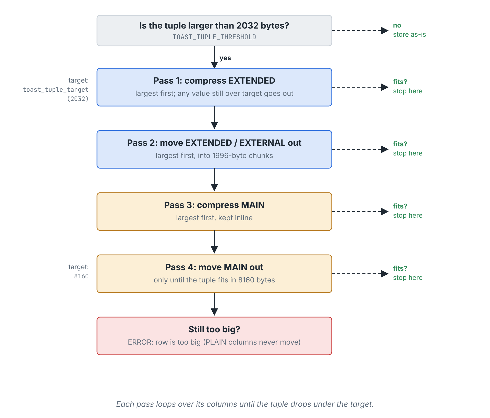

# PG Phriday: Burnt TOAST

原作者：Shaun Thomas，pgEdge。原文发表于 2026 年 10 月 30 日：[PG Phriday: Burnt TOAST](https://www.pgedge.com/blog/burnt-toast)。

以下为原文翻译，第一人称经历、示例与性能数字均来自原作者。必要的技术说明以“译注”标出。中文翻译与校订：xiongcc。

2010 年，一家金融公司请我调整他们的 PostgreSQL 集群架构。在那里工作期间，我对 `event_log` 表有了相当深的“敬意”。不过，“敬意”可能用得不太对，说是深恶痛绝更合适。这张表是系统事件的权威记录，存着数百万行数据。

行数多本身倒不是问题。我们只保留较短时间窗口内的数据，并且经常归档。麻烦在于，其中一个没有长度限制的 `TEXT` 列，经常存放大段 XML。从这张表取数据慢得出奇，写入也同样痛苦。我们花了不少精力调整应用，尽量让它只在确实需要时才访问这张表。

起初，这张表的表现让我又困惑又恼火，直到我想起 TOAST。PostgreSQL 把它解释为 The Oversized-Attribute Storage Technique，也就是“超大属性存储技术”。这个缩写听起来很无害，但实际工作的 DBA 对它往往又爱又恨。至于这种感情是否公平，那是另一回事。

从表面上看，TOAST 就是把大块数据存到别处，让元组保持较小的体积，避免超过通常只有 8KB 的数据页。PostgreSQL 会为大字段建立配套的 TOAST 表，把内容切成若干块，再在原行中保存一个指针。它很巧妙地解决了行过大的问题，但也带来了值得仔细考察的性能影响。

接下来看看，为什么大文本列会让 DBA 如此头疼。

## 从一张事件表开始

要理解当年的 `event_log` 问题，可以先构造一张类似的表：

<!-- verify:setup -->
```sql
CREATE TABLE event_log
(
  event_id       BIGINT GENERATED ALWAYS AS IDENTITY PRIMARY KEY,
  ticker         VARCHAR(4) NOT NULL,
  strike         INT NOT NULL,
  shares         INT NOT NULL,
  event_data     JSON NOT NULL -- 当年用的是 XML，这里换成 JSON
  --- 此处还有其他列
);
```

然后填入 10 万行数据。这个数量已经足以让问题显现。数据列需要比较大，但也不必大得离谱：每个 JSON 对象最多放 1000 个字段。

<!-- verify:load -->
```sql
INSERT INTO event_log (ticker, strike, shares, event_data)
SELECT left(md5((a.id % 100)::TEXT), 4), a.id % 100, a.id % 100 * 10,
       (SELECT jsonb_object_agg('field_' || f, random(1, 1000))
          FROM generate_series(1, id % 1000 + 1 ) f)
  FROM generate_series(1, 100000) a (id);
```

这些数据都去了哪里？并不是全都留在 `event_log` 的主表中。PostgreSQL 把其中相当一部分存进了 TOAST 表。可以从系统目录 `pg_class` 找到相关对象：

<!-- verify:catalog -->
```sql
SELECT c.relname, t.relname AS toast_table, i.relname AS toast_index
  FROM pg_class c
  JOIN pg_class t ON t.oid = c.reltoastrelid
  JOIN pg_index x ON x.indrelid = t.oid
  JOIN pg_class i ON i.oid = x.indexrelid
 WHERE c.relname = 'event_log';
```

```text
  relname  |  toast_table   |     toast_index
-----------+----------------+----------------------
 event_log | pg_toast_16401 | pg_toast_16401_index
```

这条查询展示了三个相关对象：主表、TOAST 表，以及 TOAST 表的索引。并不是每张表都会如此，但如果包含可能需要 TOAST 存储的变长类型，通常就会有配套的 TOAST 表。本例中的 JSON 列可以存放很大的值，因此 PostgreSQL 在建表时便准备好了相应的存储对象。

至于哪些内容会真正存进去，就没这么简单了。

## 压缩与行外存储的顺序

PostgreSQL 按照存储策略处理字段值。系统目录 `pg_type` 的 `typstorage` 列记录了各类型的默认策略，一共有四种：

| 策略 | 行为 |
| --- | --- |
| `PLAIN`（`p`） | 保留在行内，不压缩。`INT`、`TIMESTAMPTZ` 等定长类型默认使用此策略。 |
| `MAIN`（`m`） | 允许压缩，最后才考虑移到行外。`NUMERIC` 默认使用此策略。 |
| `EXTERNAL`（`e`） | 允许移到行外，但不压缩。 |
| `EXTENDED`（`x`） | 既允许压缩，也允许移到行外。`TEXT`、`BYTEA`、`JSONB` 及多数支持 TOAST 的变长类型默认使用此策略。 |

PostgreSQL 会依次尝试压缩和行外存储，让整个元组缩小到目标大小；必要时还会继续处理，直到它能放入一个数据页。过程如下：



*原图：Shaun Thomas / pgEdge。图中的字节数对应常见的 8KB 数据页构建。*

图中的四轮处理可以这样理解：

1. **优先压缩 `EXTENDED` 列**：先处理较大的值；`EXTENDED` 或 `EXTERNAL` 的单个值如果仍超过本轮可容纳的大小，也可以直接移到行外。
2. **移出 `EXTENDED` 和 `EXTERNAL` 列**：同样优先处理较大的值，行外数据切成最多 1996 字节的块。
3. **压缩 `MAIN` 列**：尽量把这些值留在主表中。
4. **最后才移出 `MAIN` 列**：此时目标放宽到单页能够容纳的大小，图中为 8160 字节。如果仍放不下，就报行过大的错误。`PLAIN` 列始终不会被移出。

每轮都在达到目标后停止，不会无条件处理所有列。常规目标在图中为 2032 字节。

`JSON` 默认使用 `EXTENDED`，因此本例的数据也遵循这一策略。查看几行就能看到区别：

<!-- verify:inspect-values -->
```sql
SELECT ctid, event_id, length(event_data::TEXT) AS chars,
       pg_column_size(event_data) AS stored_bytes,
       pg_column_toast_chunk_id(event_data) AS toast_id
  FROM event_log
 WHERE event_id BETWEEN 335 AND 340
 ORDER BY event_id;
```

```text
  ctid  | event_id | chars | stored_bytes | toast_id
--------+----------+-------+--------------+----------
 (57,2) |      335 |  5907 |         1981 |
 (57,3) |      336 |  5930 |         2004 |    16414
 (57,4) |      337 |  5942 |         1987 |    16415
 (57,5) |      338 |  5953 |         2005 |    16416
 (57,6) |      339 |  5978 |         1996 |    16417
 (57,7) |      340 |  5988 |         2034 |    16418
```

`toast_tuple_target` 控制 TOAST 处理希望达到的元组大小，默认约为 2KB。上面的第一行压缩后，整个元组仍能留在这个目标以内，因此没有移到行外；后面几行则出现了行外值的标识。

> 译注：约 2KB 的目标针对**整个元组**，包括其他列和元组头，不是某一列压缩后的独立上限。因此上表中只有 1987 字节的值也可能被移到行外。TOAST 处理的启动阈值与后续希望达到的目标也有所区别，后面会再讨论。

查看第 57 个数据块，区别就更明显了：

<!-- verify:inspect-page -->
```sql
CREATE EXTENSION IF NOT EXISTS pageinspect;

SELECT lp, lp_len
  FROM heap_page_items(get_raw_page('event_log', 57))
 LIMIT 5;
```

```text
 lp | lp_len
----+--------
  1 |   2022
  2 |   2029
  3 |     66
  4 |     66
  5 |     66
```

这里的 `57` 来自前一查询的 `ctid`，表示块号；复现时应取自己查询得到的块号。随机数据、块号和 TOAST 对象编号会随实际运行而变化。

保留行内值的元组明显更大。对于移到行外的值，主表只保留指针，所以元组可以小很多。行外数据还会被拆成每块最多 1996 字节的片段，按顺序存为 TOAST 表中的多行。

读取并展开这样的值，需要付出额外成本：

- 通过 TOAST 索引定位数据块，并读取 TOAST 表中的相应行。
- 把片段重新组装起来，额外消耗内存；数据块多时，这个开销也会增加。
- 如果数据已经压缩，还需要解压，消耗内存和 CPU。

这样看，TOAST 似乎只会让读取变慢。实际情况如何？

## 大字段的读取成本，与主表的扫描成本

现在已经有一张部分数据存放在 TOAST 表中的表。接下来看看，访问所有行的大字段会发生什么。

先创建一份副本，把 `event_data` 的存储策略改成 `MAIN`。它仍允许压缩，但会尽量把值保留在行内，只有整个元组无法放入单页时才考虑移到行外：

<!-- verify:main-copy -->
```sql
CREATE TABLE non_toast (LIKE event_log INCLUDING INDEXES);
ALTER TABLE non_toast ALTER event_data SET STORAGE MAIN;
INSERT INTO non_toast SELECT * FROM event_log;
```

然后对比读取 `field_999` 的成本：

<!-- verify:field-extended -->
```sql
EXPLAIN (ANALYZE, BUFFERS, COSTS OFF, SUMMARY OFF)
SELECT count(event_data->>'field_999') FROM event_log;
```

```text
 Aggregate (actual time=6589.068..6589.070 rows=1.00 loops=1)
   Buffers: shared hit=246472 read=41655
   ->  Seq Scan on event_log (actual time=0.221..17.022 rows=100000.00 loops=1)
         Buffers: shared read=5969
```

<!-- verify:field-main -->
```sql
EXPLAIN (ANALYZE, BUFFERS, COSTS OFF, SUMMARY OFF)
SELECT count(event_data->>'field_999') FROM non_toast;
```

```text
 Aggregate (actual time=6166.877..6166.880 rows=1.00 loops=1)
   Buffers: shared read=40754
   ->  Seq Scan on non_toast (actual time=0.180..51.434 rows=100000.00 loops=1)
         Buffers: shared read=40754
```

共享缓冲区在这里发挥了重要作用。把 `hit` 与 `read` 相加，使用 TOAST 的版本共有 288127 次缓冲区访问，行内版本则是 40754 次。另一方面，使用 TOAST 的主表要小得多：

<!-- verify:heap-sizes -->
```sql
SELECT pg_size_pretty(pg_relation_size('event_log')) AS event_log,
       pg_size_pretty(pg_relation_size('non_toast')) AS non_toast;
```

```text
 event_log | non_toast
-----------+-----------
 47 MB     | 318 MB
```

> 译注：原文将上述缓冲区访问合计称为 reads。`hit` 是共享缓冲区命中；`read` 表示将块读入共享缓冲区，也可能命中操作系统缓存。两者的合计不能当作物理磁盘读取次数。这里的 `pg_relation_size` 比较的是主表堆大小，不包含 TOAST 表及索引。

PostgreSQL 扫描较小的主表更快，但随后又花了不少时间访问 TOAST 表。主表大小的差别，也让其他操作表现得很不一样。例如，不展开 JSON 内容，只计算非空值的数量：

<!-- verify:count-extended -->
```sql
EXPLAIN (ANALYZE, BUFFERS, COSTS OFF, SUMMARY OFF)
SELECT count(event_data) from event_log;
```

```text
 Aggregate (actual time=26.397..26.398 rows=1.00 loops=1)
   Buffers: shared hit=282 read=5567
   ->  Seq Scan on event_log (actual time=0.369..13.726 rows=100000.00 loops=1)
         Buffers: shared hit=282 read=5567
```

<!-- verify:count-main -->
```sql
EXPLAIN (ANALYZE, BUFFERS, COSTS OFF, SUMMARY OFF)
SELECT count(event_data) from non_toast;
```

```text
 Aggregate (actual time=91.840..91.841 rows=1.00 loops=1)
   Buffers: shared hit=282 read=40670
   ->  Seq Scan on non_toast (actual time=0.303..74.908 rows=100000.00 loops=1)
         Buffers: shared hit=282 read=40670
```

26ms 对 91ms。再看跳过大量行之后取一行：

<!-- verify:offset-extended -->
```sql
EXPLAIN (ANALYZE, BUFFERS, COSTS OFF, SUMMARY OFF)
SELECT * from event_log LIMIT 1 OFFSET 99999;
```

```text
 Limit (actual time=16.579..16.581 rows=1.00 loops=1)
   Buffers: shared hit=377 read=5592
   ->  Seq Scan on event_log (actual time=0.215..12.908 rows=100000.00 loops=1)
         Buffers: shared hit=377 read=5592
```

<!-- verify:offset-main -->
```sql
EXPLAIN (ANALYZE, BUFFERS, COSTS OFF, SUMMARY OFF)
SELECT * from non_toast LIMIT 1 OFFSET 99999;
```

```text
 Limit (actual time=53.276..53.277 rows=1.00 loops=1)
   Buffers: shared hit=188 read=40566
   ->  Seq Scan on non_toast (actual time=0.240..49.551 rows=100000.00 loops=1)
         Buffers: shared hit=188 read=40566
```

这次是 16ms 对 53ms。

> 译注：`count(event_data)` 只需判断值是否为 NULL，不必还原 JSON 内容。上面的 `EXPLAIN ANALYZE` 也没有要求输出序列化，不会把返回行的大字段完整转换为客户端结果，因此它主要展示扫描和跳过行的成本，不包含完整的数据输出与网络传输成本。

更新也有差别。在 psql 中打开计时：

<!-- verify:update -->
```sql
\timing on

UPDATE event_log
   SET shares = shares + 1
 WHERE ticker = 'b53b';

UPDATE non_toast
   SET shares = shares + 1
 WHERE ticker = 'b53b';
```

原文中，两次更新分别耗时：

```text
event_log: 62.412 ms
non_toast: 128.282 ms
```

主表堆的大小会直接影响这些操作。TOAST 指针让堆中的每行更小，尤其是在根本不需要访问大字段时，这本身就是一种优化。更新其他列时，未改变的行外值通常还能复用，无需重新生成一份 TOAST 数据。

这让我重新看待当年的问题。`event_log` 的麻烦未必在于 TOAST 本身，而在于应用如何访问 `event_data`。而这有办法改善。

## 把大字段拆到单独的表

当年的处理方式是拆表。这里的示例只有 10 万行，但真实表有数百万行，仅主表堆就超过 1GB；加上那些大型 XML 值的 TOAST 数据，总大小超过 20GB。

如果应用里到处都是 `SELECT *`，反复查找并还原行外值，成本迟早会显现。即使不考虑磁盘 I/O，也会多出大量网络传输。“那就明确列出需要的列！”我当然同意。可要修改 ORM 生成的查询，以及五年间积累下来的手写 SQL，并没有那么轻松。

拆分大致如下：

<!-- verify:split -->
```sql
CREATE TABLE event_new
(
  event_id       BIGINT GENERATED BY DEFAULT AS IDENTITY PRIMARY KEY,
  ticker         VARCHAR(4) NOT NULL,
  strike         INT NOT NULL,
  shares         INT NOT NULL
  --- 此处还有其他列
);

CREATE TABLE event_log_data
(
  event_id       BIGINT GENERATED BY DEFAULT AS IDENTITY PRIMARY KEY,
  event_data     JSON NOT NULL
);

INSERT INTO event_new (event_id, ticker, strike, shares)
SELECT event_id, ticker, strike, shares
  FROM event_log;

INSERT INTO event_log_data (event_id, event_data)
SELECT event_id, event_data
  FROM event_log;

ALTER TABLE event_log RENAME TO event_log_old;
ALTER TABLE event_new RENAME TO event_log;
```

> 译注：这里保留原文的拆表示例。复制时显式写入 `event_id`，不会推进新表的 identity 序列；接入后续写入前，应将主表序列对齐到现有最大 ID。子表必须使用主表生成的同一个 `event_id`，才能保持两表对应，不能分别依赖两套序列生成关联键。

这样做首先让应用的主表连 TOAST 指针也不必保存了。其次，`event_data` 原本既有行内值，也有行外值；拆表之后，那些未达到行外存储条件的值也一并搬走了。两张新表的堆大小如下：

<!-- verify:split-sizes -->
```sql
SELECT pg_size_pretty(pg_relation_size('event_log')) AS event_log,
       pg_size_pretty(pg_relation_size('event_log_data')) AS non_toast;
```

```text
 event_log | non_toast
-----------+-----------
 5096 kB   | 46 MB
```

第二列虽然沿用了原文的 `non_toast` 别名，这里实际显示的是 `event_log_data` 的主表堆大小。

主表的行密度提高了：每页能容纳更多行，表示这些核心字段所需的页数也更少。整个主表堆从 47MB 缩小到约 5MB，缩小了九倍以上。只访问这些字段的操作也就能受益。如果高性能系统里的大字段可以移到按需连接的附表，值得考虑这种设计。

把 `toast_tuple_target` 调得任意小，能否得到同样的效果？并不能。只有元组大于编译时确定的 `TOAST_TUPLE_THRESHOLD`，TOAST 处理才会启动。已经低于这个阈值的元组，不会仅仅因为降低目标值就自动移到行外。

拆表之后，应用访问大字段需要连接。可以先用视图把两张表组合起来：

<!-- verify:view -->
```sql
CREATE OR REPLACE VIEW event_log_all AS
SELECT e.*, d.event_data
  FROM event_log e
  LEFT JOIN event_log_data d USING (event_id);
```

<!-- verify:view-plan -->
```sql
EXPLAIN (ANALYZE, BUFFERS, COSTS OFF, SUMMARY OFF)
SELECT event_id, strike, shares
  FROM event_log_all WHERE event_id = 42;
```

```text
 Index Scan using event_new_pkey on event_log e (actual time=0.032..0.034 rows=1.00 loops=1)
   Index Cond: (event_id = 42)
   Index Searches: 1
   Buffers: shared hit=3
```

`LEFT JOIN` 让附表的数据成为可选部分，即使我们知道每行实际上都有对应的大字段。这里右表的 `event_id` 又是主键，每个左表行至多匹配一行。因此，不引用右表字段的查询可以消除这次连接，只访问主表。

## 选择压缩算法

从 PostgreSQL 14 开始，还可以选择压缩算法：继续使用内置的 `pglz`，或者在构建支持时使用 `lz4`。默认算法由 `default_toast_compression` 决定：

<!-- verify:compression-default -->
```sql
SHOW default_toast_compression;
```

```text
 default_toast_compression
---------------------------
 pglz
```

也可以在 `CREATE TABLE` 或 `ALTER TABLE` 中通过 `COMPRESSION` 指定列的压缩算法，用于后续写入；已有值不会因此立即重新压缩。

`pglz` 有些值得了解的取舍：跳过不足 32 字节的输入，要求至少节省 25% 的空间，如果在最初约 1KB 的处理中找不到可压缩的匹配，就提早放弃。最后这一点可以通过下面的例子观察：

<!-- verify:compression-example -->
```sql
CREATE EXTENSION pgcrypto;

CREATE TABLE squeeze (method TEXT, payload TEXT);

ALTER TABLE squeeze ALTER payload SET COMPRESSION pglz;
INSERT INTO squeeze VALUES ('pglz', encode(gen_random_bytes(1024), 'base64') || repeat('Postgres! ', 1000));

ALTER TABLE squeeze ALTER payload SET COMPRESSION lz4;
INSERT INTO squeeze VALUES ('lz4', encode(gen_random_bytes(1024), 'base64') || repeat('Postgres! ', 1000));

SELECT method, length(payload) AS chars,
       pg_column_size(payload) AS stored,
       pg_column_compression(payload) AS compression,
       pg_column_toast_chunk_id(payload) AS toasted_chunk
  FROM squeeze;
```

```text
 method | chars | stored | compression | toasted_chunk
--------+-------+--------+-------------+---------------
 pglz   | 11385 |  11385 |             |        415076
 lz4    | 11385 |   1517 | lz4         |
```

> 译注：这段输出展示了原作者遇到的情况：随机前缀让 `pglz` 提早放弃，而 `lz4` 成功压缩。随机数据中也可能出现匹配，实际运行时 `pglz` 未必每次都放弃。源码中的提前放弃检查依据是当时已产生的输出字节数，不是严格固定地只检查前 1024 个输入字节。

算法选择也会影响耗时。原文分别做了以下测试，每种算法写入 10 万行，每行把 `Postgres!` 重复 10000 次：

<!-- verify:benchmark-pglz -->
```sql
-- 先测试 pglz
TRUNCATE TABLE squeeze;
ALTER TABLE squeeze ALTER payload SET COMPRESSION pglz;

\timing on

INSERT INTO squeeze
SELECT 'pglz', repeat('Postgres!', 10000)
  FROM generate_series(1, 100000);

SELECT sum(length(payload)) FROM squeeze;
```

```text
INSERT: 52179.203 ms (00:52.179)

    sum
------------
 9000000000

SELECT: 17108.284 ms (00:17.108)
```

<!-- verify:benchmark-lz4 -->
```sql
-- 再测试 lz4
TRUNCATE TABLE squeeze;
ALTER TABLE squeeze ALTER payload SET COMPRESSION lz4;

INSERT INTO squeeze
SELECT 'lz4', repeat('Postgres!', 10000)
  FROM generate_series(1, 100000);

SELECT sum(length(payload)) FROM squeeze;
```

```text
INSERT: 1774.048 ms (00:01.774)

    sum
------------
 9000000000

SELECT: 20929.714 ms (00:20.930)
```

在这组数据上，`lz4` 对应的读取查询大约慢了 20%，但写入快了约 29 倍，差距相当明显。

> 译注：原文把写入差距概括为“压缩快了 30 多倍”，根据给出的耗时计算约为 29.4 倍。这里比较的是整条 `INSERT` 和 `sum(length(payload))` 的耗时，包含压缩、解压之外的工作，并不是单独测量压缩库的吞吐率。

## 回头看 TOAST

遇到问题时，人总想找个归咎的对象。当年我一直觉得，应用里的 `event_log` 表表现这么差，都是 TOAST 的错。每当有人抱怨，或者某条糟糕的查询进入应用、碰到了大字段，导致页面加载时间变成原来的四倍，甚至直接超时，我脑中首先想到的都是 TOAST。

某种程度上，这还真与 TOAST 有关，只不过问题在于它没有那么积极地把数据搬走。PostgreSQL 使用 `TOAST_TUPLE_THRESHOLD`，就是为了避免对小元组也启动拆分、压缩、行外存储这一整套昂贵的流程。但如果能够任意指定哪些值需要移出，情况又会不同。

现有四种策略都不能表达“把超过 100 字节的值移到行外，超过 2KB 时再压缩”。对某些中等大小的列，`EXTERNAL` 值得考虑：在元组满足 TOAST 处理条件时，它可以让主表更紧凑，而不足 1KB 的数据往往也未必有很好的压缩收益。

否则，我们就得在表结构上作出取舍，让真正需要大字段的应用路径多做一次连接。视图可以在一定程度上缓解使用上的不便，但与保留完整的一张表相比，终究多了一层设计。也不能一见到大字段就拆表，否则结构会变得难以维护；并非每个大字段都适合从日常访问中分离。

TOAST 提供的是一个实用的折中。主表只需付出一个指针的空间，就能把大段文本留在别处，让不需要这些内容的操作受益。对于适合的数据，切换到 `lz4` 还可以显著降低写入时的压缩开销。

所以，不必一看到 PostgreSQL 的 TOAST 就担心。理解数据实际放在哪里、查询是否真的需要展开它，往往比一味避免 TOAST 更有帮助。

## 参考资料

- 原文：[Shaun Thomas：PG Phriday: Burnt TOAST](https://www.pgedge.com/blog/burnt-toast)。
- PostgreSQL 18：[TOAST 存储机制](https://www.postgresql.org/docs/18/storage-toast.html)、[列存储策略与压缩选项](https://www.postgresql.org/docs/18/sql-createtable.html)、[EXPLAIN 的输出序列化选项](https://www.postgresql.org/docs/18/sql-explain.html)。
- PostgreSQL 18 源码：[TOAST 阈值与块大小](https://github.com/postgres/postgres/blob/REL_18_STABLE/src/include/access/heaptoast.h)、[四轮处理顺序](https://github.com/postgres/postgres/blob/REL_18_STABLE/src/backend/access/heap/heaptoast.c)、[pglz 的提前放弃策略](https://github.com/postgres/postgres/blob/REL_18_STABLE/src/common/pg_lzcompress.c)。
