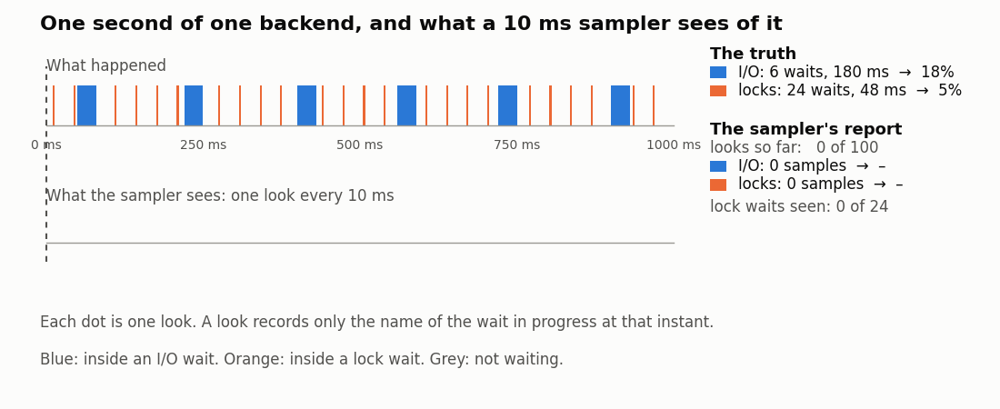
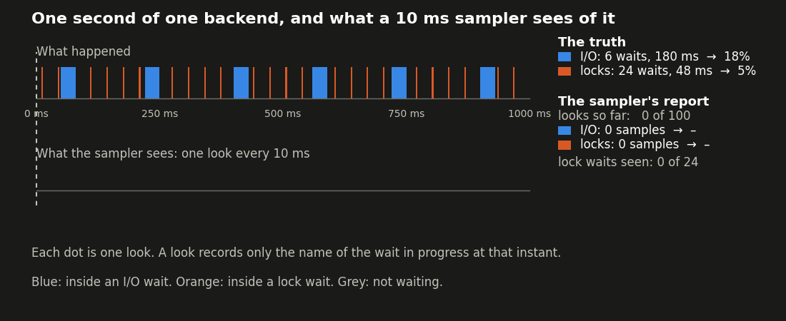
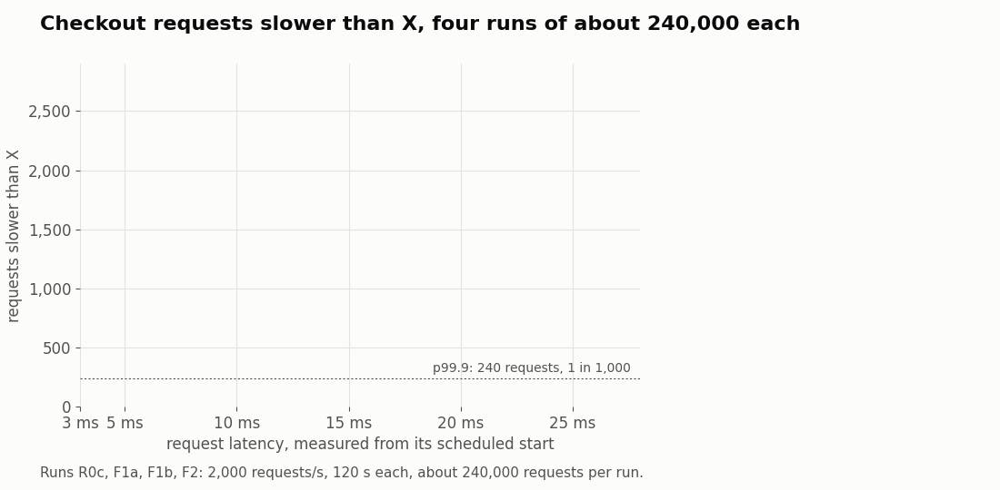
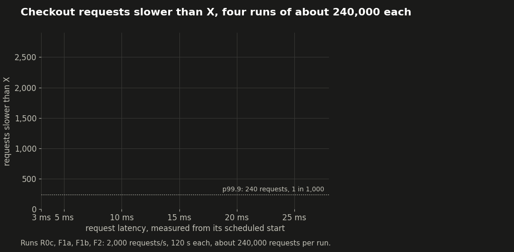
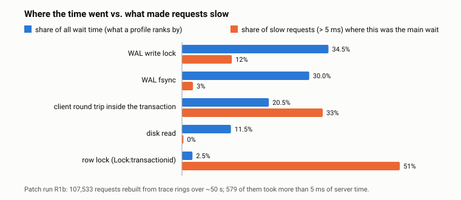
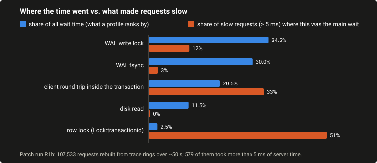
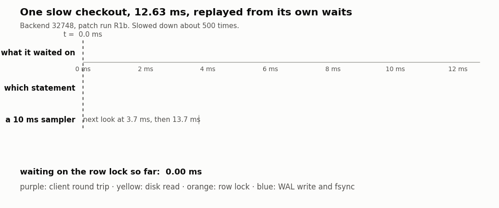
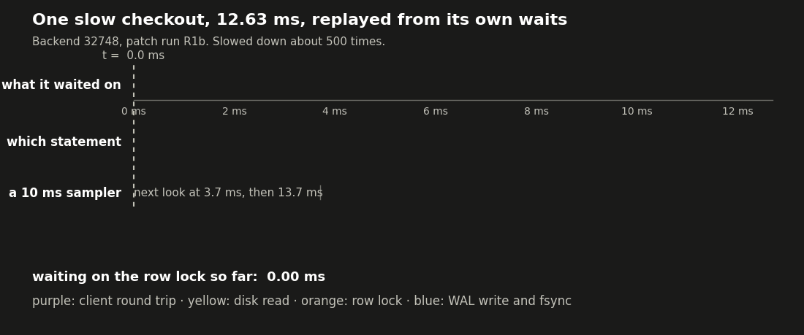

# What your Postgres is waiting for, and why the dashboard can't tell you

原作者：Dmitry Fomin，PostgresAI。原文发表于 2026 年 11 月 3 日：[What your Postgres is waiting for, and why the dashboard can't tell you](https://postgres.ai/blog/20261103-what-postgres-is-waiting-for)。

以下为原文翻译，案例、图表与测试数字来自原作者构造的复现负载。中文翻译与校订：xiongcc。

一个结账请求很慢。监控仪表盘显示，时间主要花在提交路径和磁盘读取上。团队据此尝试了两项优化，最慢的那些请求却依然很慢。真正的原因是一把锁，在仪表盘上只排第五，占总时间的 2%。

本文借助 PostgreSQL 目前提供的信息，解释为什么等待事件仪表盘可以准确反映时间花在哪里，却无法据此直接解释请求为什么慢。后续文章会继续介绍如何找到这些原因的工具。

## 等待事件究竟记录了什么

当 PostgreSQL 后端进程准备等待某个资源时，会向共享内存中属于自己的槽位写入一个 4 字节的等待事件编码；等待结束后，再将它清除。查询 `pg_stat_activity` 时，这个编码会被转换成类型和名称，例如 `Lock:transactionid`、`IO:DataFileRead` 或 `Client:ClientRead`。PostgreSQL 18 有大约 275 个等待事件，分为十类，后续版本还会继续增加。

通过 `pg_stat_activity.wait_event` 就能读取当前的等待事件。

这套机制本身没有读取时钟，也没有计数或记录日志。等待事件只是一个实时标志，表示“这个后端进程此刻正在这里等待”。还要注意它覆盖的时间范围：进程在准备休眠前设置标志，只有醒来并重新得到执行机会后才会清除。如果 CPU 很忙，被唤醒后等待调度的时间也会算在这一段等待中。因此，它并不是对资源阻塞时间的纯粹测量。

## 请求时间中的两部分

请求耗时可以分为在 CPU 上执行的时间，以及等待其他事情的时间。

`EXPLAIN ANALYZE` 按执行计划节点展示时间：运行了哪些节点，各自产生多少行，估算偏差出现在哪里。启用 `track_io_timing` 后，它也会报告 I/O 时间。节点耗时是经过的实际时间，包含其中发生的等待，但计划不会逐一说明，哪部分时间在等待、又在等什么。

一个查询即使把 90% 的时间花在等锁上，执行计划中的节点也可能看起来都没有明显问题，只留下一个较大的耗时数字，看不出这段时间主要是在等待。

等待事件可以提供另一部分信息，但它直接报告的，只是此刻尚未结束的那次等待。

## 仪表盘如何观察等待

由于这个标志只表示当前状态，不保存历史，基于等待事件的监控工具通常采用相同的方法：定时读取标志，统计每种状态出现了多少次，再用样本占比估计时间占比。

`pg_wait_sampling` 默认每 10ms 采样一次。Amazon RDS Performance Insights、Azure Database for PostgreSQL Query Store，以及 pganalyze、Datadog Database Monitoring、pgwatch 和 PostgresAI 自己的监控，也会使用这类采样信息展示等待情况。

<figure class="themed-image">
  
  
  <figcaption>图 1：样本能大致反映两类等待的时间占比，但 24 次锁等待中只有 6 次被采到，无法据此精确还原等待次数和每次时长。原图：Dmitry Fomin / PostgresAI。</figcaption>
</figure>

采样确实有用。作者将这些占比视为时间分布的无偏估计，样本足够多时便会接近实际占比。在后面的案例中，它们与逐次计时的差异约在两个百分点以内。采样成本低，可以持续运行，不必等到故障发生前才开始准备，通常能把排查引向正确的子系统。

> 译注：无偏估计需要相应的采样假设。固定周期采样如果恰好与周期性负载同步，仍可能产生偏差；不能仅凭样本数量多，就保证占比一定准确。

## 单靠占比回答不了的三个问题

**发生了多少次等待，每次有多长？**

某类等待占用的总时间，取决于等待次数与平均时长。一分钟内，`IO:WalSync` 累计占了 6 秒，可能是 30000 次、每次 200µs 的 WAL 刷盘，说明提交频繁而磁盘响应正常；也可能是 300 次、每次 20ms，说明刷盘延迟较高。占比相同，处理方向却不同。

有两类操作，PostgreSQL 还会在其他地方保存次数和累计耗时。I/O 可以看 `pg_stat_io`：从 PostgreSQL 18 开始，其中也包含 WAL；普通 I/O 计时需要 `track_io_timing`，WAL 则需要 `track_wal_io_timing`。PostgreSQL 19 的 `pg_stat_lock` 会统计等待超过 `deadlock_timeout`、并最终成功获取的重量级锁。这些数据可以用来计算平均值。

但平均值仍会隐藏分布：30000 次、每次 200µs，与 29700 次、每次 100µs，加上 300 次、每次 10.1ms，次数、总时间和平均值完全相同。

**比采样间隔还短的等待发生了什么？**

以 10ms 为间隔采样，一次 2ms 的等待大约只有五分之一的机会被看到。如果一小时内只发生 20 次这样的等待，总共是 40ms；这一小时虽然有 360000 次采样，平均也只能采到约 4 个相关样本。凭这四个样本，无法知道确切发生了多少次等待，也无法知道每次持续多久。

**某一个请求究竟经历了什么？**

样本记录的是状态，而非状态切换。即使采样器保存历史，例如 `pg_wait_sampling` 默认保存最近 5000 个样本，也只是保留它看到的状态顺序；在繁忙服务器上，这可能只覆盖几秒。它没有精确的请求边界，没有每次等待的完整时长，也不知道两次采样之间发生了什么。

“为什么偏偏是这个请求慢？”单靠占比无法回答。

## 现有工具分别能提供什么

| 想知道的问题 | 工具 | 能得到的信息 |
| --- | --- | --- |
| 此刻谁阻塞了谁 | `pg_locks`、`pg_blocking_pids()` | 等待仍在发生时，找出阻塞者的 PID。 |
| 哪次锁等待超过了 `deadlock_timeout` | `log_lock_waits`，PostgreSQL 18 及以前默认关闭，19 默认开启 | 超过阈值时记录仍在等待的日志，包含持有者和等待队列；成功获取后，再记录等待了多少毫秒。默认阈值为 1 秒。 |
| 每条语句累计做了多少工作 | `pg_stat_statements` | 调用次数、累计和平均耗时、读取块数等，没有完整的等待类型拆分。 |
| I/O 次数与耗时 | `pg_stat_io`；单个后端可用 `pg_stat_get_backend_io()` | 按操作类型统计次数与累计时间，没有延迟分布和单次最坏值。 |
| 重量级锁的等待次数与耗时 | PostgreSQL 19 的 `pg_stat_lock` | 按锁类型统计超过 `deadlock_timeout` 且最终成功获取的等待。 |
| 执行计划中的时间花在哪里 | `EXPLAIN (ANALYZE, BUFFERS)` | 节点实际耗时，以及启用 I/O 计时后得到的 I/O 时间。 |
| 持续观察服务器的时间分布 | `pg_wait_sampling` 等采样器或仪表盘 | 按等待事件、查询等维度展示时间占比。 |

后面的实验环境具备这些工具。但其中的锁等待通常只有几毫秒到约 20ms，远低于 `log_lock_waits` 和 `pg_stat_lock` 默认关注的 1 秒阈值，也短到很难靠手工调用 `pg_blocking_pids()` 抓住。

## 一个结账变慢的复现案例

下面的负载用于复现作者反复遇到的一类问题。脚本、README 和摘要保存在 `pg_wait_tracer` 仓库的 `checkout-tail-20261022` 与 `reruns-20261023` 目录中；原始请求日志和追踪记录位于 `evidence-20261023` 发布附件。原文图表由这些数据生成，相关链接见文末。所有运行都使用真实磁盘上的普通 SQL，没有用 `pg_sleep` 或人为注入延迟。

一个网店结账事务依次完成三件事：读取商品目录中的一行，更新 1000 个库存条目中的一个，然后提交。由于商品目录放不进内存，读取经常需要访问磁盘。16 个客户端通过 `pgbench` 每秒发送 2000 个请求。普通请求约耗时 1.5ms，尾部请求则达到 10–25ms。延迟从每个请求计划开始的时刻算起，采用 `pgbench` 固定速率模式的口径。

表中的主要测试使用 PostgreSQL 开发版 `20devel`，已经应用后续文章介绍的追踪补丁，但在这些对照测试中关闭追踪。作者也在未打补丁的 PostgreSQL 18 上重复了实验，看到类似的采样结果，`Lock:transactionid` 占 3.0%，尾延迟的原因也相同。

同时，一个后台任务负责重新计算预留库存。它大约每秒执行五次，每次用一条 `UPDATE` 处理连续的 100 个商品，耗时约 17ms。这 100 行上的锁一直持有到事务结束。

### 仪表盘显示了什么

针对处理请求的后端进程，`pg_wait_sampling` 采样 120 秒，并排除 `Client:ClientRead`，即等待客户端发送数据的时间，得到：

| 等待事件 | 占比 |
| --- | ---: |
| `LWLock:WALWrite` | 32.7% |
| `IO:WalSync` | 29.3% |
| CPU | 22.4% |
| `IO:DataFileRead` | 12.3% |
| `Lock:transactionid` | 2.3% |

这里的 CPU，是作者给“采样时没有等待事件，即 NULL”的样本所用的标签：可能在 CPU 上运行，也可能处于 PostgreSQL 尚未标记的等待中。按查询统计，`COMMIT` 占了 78% 的样本。

> 译注：NULL 也可能包含进程尚未获得 CPU 调度的时间，因此这里的 CPU 标签不等同于操作系统测得的 CPU 使用时间。

仪表盘将排查方向指向了提交路径，其次是磁盘读取。就整个负载的时间分布而言，这个结果没有错。

### 按仪表盘提示尝试的两项优化

提交路径占比高，首先想到降低提交成本；磁盘读取占比高，接着想到增加内存。作者分别尝试了这两项改变，之后又加入第三种方案作对照。

| 测试 | 改变 | 平均耗时 | p99 | p99.9 | 最大耗时 | 超过 5ms 的请求数 |
| --- | --- | ---: | ---: | ---: | ---: | ---: |
| 基线 | 不作改变 | 1.51 ms | 3.08 ms | 10.98 ms | 26.7 ms | 972 |
| 方案 A | `synchronous_commit = off` | 0.83 ms | 1.74 ms | 11.36 ms | 25.7 ms | 688 |
| 方案 B | `shared_buffers` 设为 2 GiB，预热，不限制内存 | 1.34 ms | 2.82 ms | 11.30 ms | 23.9 ms | 954 |
| 方案 C | 后台任务每批处理 5 行 | 1.52 ms | 2.92 ms | 5.78 ms | 10.0 ms | 388 |

方案 A 将平均耗时近乎减半，代价是发生崩溃时，已经返回成功的部分事务可能丢失；尾部请求却没有明显改善。方案 B 消除了磁盘读取，尾部仍然没有明显改善。

方案 C 没有修改数据库配置，却使 p99.9 从约 11.0ms 降到 5.8ms，最慢请求从 26.7ms 降到 10.0ms。

<figure class="themed-image">
  
  
  <figcaption>图 2：横轴为延迟阈值，纵轴为超过该阈值的请求数。p99.9 是 99.9% 的请求耗时不超过的分位点。约 8ms 以上，方案 A、B 与基线接近，方案 C 的慢请求更少。动画依次展示四组测试。原图：Dmitry Fomin / PostgresAI。</figcaption>
</figure>

等待占比本身没有直接指向方案 C。这个办法是怎样找到的？

### 真正拖慢请求的等待

作者重新运行基线负载，这次开启逐次等待的精确计时，记录每次等待及其时长，同时记录语句和事务的起止位置。这轮运行约 50 秒，可以据此重建 107533 个请求，其中 579 个请求的服务端耗时超过 5ms。

前面的表按客户端 `pgbench` 观察到的延迟统计，窗口为 120 秒，因此请求数量与这里不同。逐次记录的价值在于，可以只选出慢请求，查看它们各自经历了哪些等待。

用于记录这些数据的工具会在后续文章中介绍，这里先看它提供的结果：

<figure class="themed-image">
  
  
  <figcaption>图 3：每组左柱是该事件占总体等待时间的比例，右柱是它成为慢请求主要等待的请求比例。两个比例的分母不同：行锁只占总体等待时间的 2.5%，却是 51% 慢请求的主要等待。原图：Dmitry Fomin / PostgresAI。</figcaption>
</figure>

图中左侧使用逐次计时得到的等待时间占比。对两种方式都覆盖的等待，它与采样结果接近：`LWLock:WALWrite` 为 34.5%，采样为 32.7%；`Lock:transactionid` 为 2.5%，采样为 2.3%。

原采样表排除了 `ClientRead`，因此没有图中的客户端往返一项；图中也没有原采样表里的 CPU 项。比较时需要注意这两个口径差异。

右侧则按慢请求统计。`Lock:transactionid` 只占总体等待时间的 2.5%，却是超过 5ms 的请求中 51% 请求的主要等待；把慢请求阈值提高到 8ms，这个比例为 65%。也就是说，一半超过 5ms、约三分之二超过 8ms 的请求，碰到了后台任务正在持有的库存行锁。整体平均值没有明显变化，因为受锁影响的请求只占所有请求的大约 0.3%。

另外约三分之一的慢请求，慢在客户端：事务仍开着，后端却停在 `Client:ClientRead`，等待 `pgbench` 发送下一条语句。这是负载生成器一侧的延迟，并非数据库执行本身变慢；逐请求观察才能把它分辨出来。

这里的“主要等待”，指某一等待事件累计占据该请求至少一半的服务端耗时；没有任何事件达到这一条件的请求，归为 CPU 或其他原因。

看其中一个请求：

<figure class="themed-image">
  
  
  <figcaption>图 4：动画将一次 12.63ms 的请求放慢约 500 倍展示。它约 87% 的时间花在一次行锁等待上；10ms 采样器在这个请求期间只能观察一两次。原图：Dmitry Fomin / PostgresAI。</figcaption>
</figure>

这次请求的约 87% 时间都在等一把行锁。仪表盘里占比较高的磁盘读取，在这个请求中只用了 0.27ms；排第一的提交路径，包括 WAL 写入和同步，也只有 0.53ms。

### 修改后台任务，并重复测试

后台任务原本一次持有 100 行的锁，持续约 17ms。方案 C 减少了同时锁定的行数，并缩短持锁时间：将这次工作拆成 20 条语句，每条处理 5 行。每条语句的服务端耗时约为 1ms，`pg_stat_statements` 中 11879 次调用的平均值为 0.97ms，因此每行锁的持有时间从约 17ms 缩短到约 1ms。

后台任务本身没有更便宜。多出 20 次往返之后，一轮任务从约 18ms 增加到约 41ms。改变的只是每次持锁的范围和时间。

> 译注：分批要伴随分批提交。若仍把 20 条更新放在同一事务里，前面取得的行锁会一直保留到最终提交，无法得到这里缩短持锁时间的效果。

上表是在原虚拟机上运行一次方案 C 的结果。之后，作者在重新创建的虚拟机上，又交替执行了三轮基线与三轮方案 C。这次有两处不同：新虚拟机更快，后台任务约耗时 8ms，而非 17ms，因此原本由锁造成的尾延迟就较小。

此外，六次运行中的四次出现了 10–150ms 的短暂停顿，每次运行出现几次，基线与修改后的负载都受到影响，原因尚未找到。比较时，作者排除了“至少 20 个请求同时出现延迟”的这些时段；这条规则没有排除原虚拟机测试中的任何时段。

排除之后，超过 5ms 的请求数，三组基线与方案 C 分别为：125 对 0、300 对 24、334 对 245。最后一组的 245 个慢请求中，有 158 个发生在停顿结束后的半秒内，此时系统正在消化积压。

`pg_wait_sampling` 按查询统计的结果也支持持锁情况得到改善：库存更新语句中，`Lock:transactionid` 的占比从 22% 降到了 0–1%。

### 仪表盘其实还能提供什么线索

有经验的 DBA 仍可能从采样信息中找到线索。`pg_wait_sampling` 按查询拆分后，库存更新语句的 `Lock:transactionid` 占比达到 41%。沿着这一条语句继续排查，就能看到锁等待。

但总体占比无法直接回答：为什么造成尾延迟的是这些锁，而不是占比约高出 27 倍的提交路径？要回答这个问题，需要把各次等待的时长、先后顺序与所属请求对应起来。

## 这件事说明了什么

等待事件仪表盘回答的是“服务器的时间花在哪里”。在这个案例中，它给出的答案是准确的。但当问题出现得少、持续时间短，或者占总体时间很小的时候，这个答案并不能直接说明某一个请求为什么慢。

要回答后一个问题，需要按请求记录每次等待及其时长。正式发布版 PostgreSQL 内核目前没有直接保存这样的完整轨迹。

原文介绍了两种途径，各有使用成本。其一是仍在 `pgsql-hackers` 上评审的 `pg_wait_event_tracing` 补丁，可以在服务端记录每次等待。前面的逐次计时数据来自它，需要使用应用了补丁的构建。

其二是 `pg_wait_tracer`，通过 eBPF 从进程外部观察同一个等待标志，可以用于未打补丁的 PostgreSQL，但追踪端需要主机访问权限。原文使用 root 运行，并在同一负载上得到相同的慢请求归因。后续两篇文章会分别介绍这两种方式，以及观察本身带来的成本。

某一个请求等了什么，以什么顺序等待，各等了多久？下一篇将介绍记录这些信息的补丁。

如果更习惯演讲形式，本文案例与另外四个案例也出现在 PGConf.EU 2026 的分享 *Stop guessing: unlocking wait events at scale with existing and new tools* 中，演讲与幻灯片链接见下方。

## 参考资料

- 原文：[Dmitry Fomin：What your Postgres is waiting for, and why the dashboard can't tell you](https://postgres.ai/blog/20261103-what-postgres-is-waiting-for)。
- 原文实验：[初始负载与结果](https://github.com/DmitryNFomin/pg_wait_tracer/tree/master/tests/results/checkout-tail-20261022)、[重复测试](https://github.com/DmitryNFomin/pg_wait_tracer/tree/master/tests/results/reruns-20261023)、[原始日志与追踪记录](https://github.com/DmitryNFomin/pg_wait_tracer/releases/tag/evidence-20261023)、[图表生成脚本](https://gitlab.com/postgres-ai/docs/-/tree/master/static/assets/blog/src/20261103-wait-events-1)。
- PostgreSQL：[18 的活动与 I/O 统计](https://www.postgresql.org/docs/18/monitoring-stats.html)、[19 的锁统计](https://www.postgresql.org/docs/19/monitoring-stats.html#MONITORING-PG-STAT-LOCK-VIEW)、[18 的锁等待日志](https://www.postgresql.org/docs/18/runtime-config-logging.html#GUC-LOG-LOCK-WAITS)、[19 的锁等待日志](https://www.postgresql.org/docs/19/runtime-config-logging.html#GUC-LOG-LOCK-WAITS)、[异步提交](https://www.postgresql.org/docs/18/runtime-config-wal.html#GUC-SYNCHRONOUS-COMMIT)、[等待标志的源码](https://github.com/postgres/postgres/blob/REL_18_STABLE/src/include/utils/wait_event.h)。
- 采样与追踪：[pg_wait_sampling](https://github.com/postgrespro/pg_wait_sampling)、[追踪补丁评审](https://commitfest.postgresql.org/patch/6984/)、[补丁代码](https://github.com/DmitryNFomin/postgres/pull/2)、[pg_wait_tracer](https://github.com/DmitryNFomin/pg_wait_tracer)。
- PGConf.EU 2026：[演讲介绍](https://www.postgresql.eu/events/pgconfeu2026/schedule/session/7907-stop-guessing-unlocking-wait-events-at-scale-with-existing-and-new-tools/)、[幻灯片](https://www.postgresql.eu/events/pgconfeu2026/sessions/session/7907/slides/952/PGConf2026_Dmitry_Fomin_Stop_%20Guessing_v4.pdf)。
