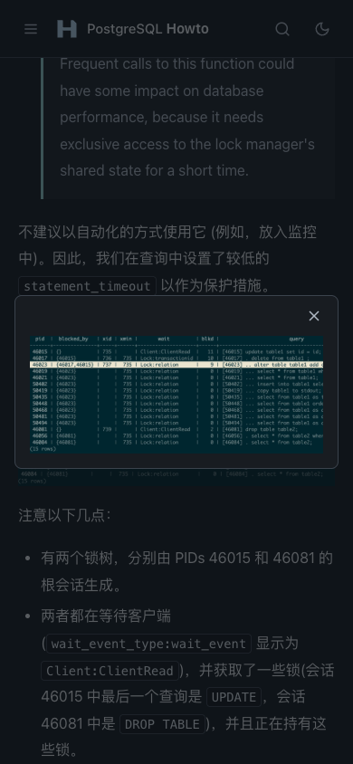
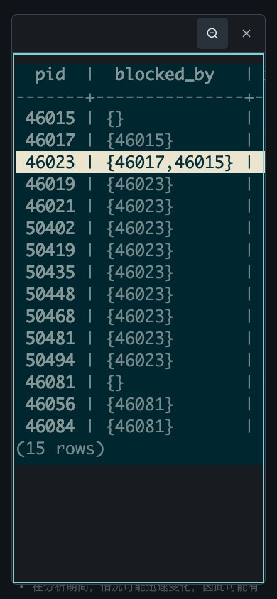
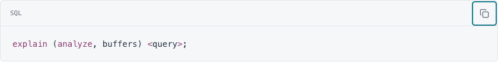

# V2.2.1 精修报告

日期：2026-10-24。基于 `c9e4e9c2b5e2a1b758d7745dedb6711f13f35f8b` 的本地精修；未提交、未推送、未部署。

## 本轮决定

保留 V2.2 已成熟的首页、Header、SVG Logo、九个专题、六条路径、日期列表、配色和正文宽度。根据本轮真实浏览器证据，仅修复图片细节查看和代码焦点裁切两处问题，没有为凑改版重新调整字号、增加卡片或装饰。

### 图片按原始尺寸阅读

原组件只有适应窗口和关闭，手机上的“放大”并不能读清小字。现在默认仍完整显示图片，工具栏增加一个尺寸切换图标；选择原始尺寸后，图片以自然 CSS 像素宽度显示，可以在弹窗内横向 / 纵向滚动。工具栏保持可见，外部页面不随原图撑宽。

| 真实锁树图片 `docs/42` | 修改前 | 修改后 |
| --- | --- | --- |
| 图片资源 | 1409×565px | 原文件不变 |
| 390px 手机默认预览宽度 | 约 324px | 324px，继续完整适应窗口 |
| 手机原始尺寸入口 | 无 | 可切到 1409px，局部平移 |
| 1440px 桌面默认预览宽度 | 约 1166px | 1166px |
| 桌面原始尺寸入口 | 无 | 可切到 1409px |
| 键盘与触摸 | 不能平移到未显示细节 | 方向键和原生触摸滚动 |
| 小图 | 原尺寸适应窗口 | 不无意义地放大，尺寸按钮禁用 |
| 重开图片 | 默认预览 | 恢复适应窗口和滚动起点 |
| 关闭 | 关闭按钮 / Esc / 背景 | 保留，并返回原图片焦点 |

没有做图像锐化、反色或裁切，不能增加原图本身不存在的分辨率。新增图标为 Lucide 的 `zoom-in` / `zoom-out`，沿用仓库许可证，不引入新依赖。

对比：

### 完整的代码焦点轮廓

原先复制按钮使用向外偏移的焦点线，碰到代码容器的裁切边界。现在仅为工具栏按钮和可聚焦代码区域设置 `outline-offset:-3px`。没有改变代码区尺寸、按钮触摸面积、缩进、复制内容或其他页面的焦点设计。

## 修改范围

| 文件 | 变更 |
| --- | --- |
| `scripts/site.js` | 懒创建预览工具栏、原始尺寸状态、窗口尺寸变化处理、加载状态及复位。沿用原生 dialog 和原有关闭 / 焦点逻辑。 |
| `styles/custom.css` | 预览弹窗、固定工具栏、内部滚动与原图状态；局部内侧焦点轮廓。继续共用既有设计变量。 |
| `images/icons/zoom-in.svg`、`zoom-out.svg` | 官方 Lucide SVG，继承现有图标体系。 |
| `maintenance/test-v2.2.1.cjs` | 新增真实文章图片专项回归，覆盖六种精确尺寸、双主题、旧 / 静态入口、平移、关闭、重开、竖图、小图和横屏。 |
| `maintenance/CATALOG.md` | 补充专项测试及维护说明。 |
| `index.html`、110 个静态 HTML | 构建自动更新 CSS / JS 资源哈希，没有手工修改生成页面。 |
| 本轮三份报告及截图 | 保存问题证据、修改理由和验收记录。 |

逐文件比较确认：111 个 HTML 与基线的差异仅为 `styles/custom.css`、`scripts/site.js` 的缓存版本号。117 个源文件（含 109 篇编号文章、元数据、搜索索引、首页 / 导航及 SEO）逐字节未变。目录修订仍为 `b921a28ec4230926`。

未增加统计服务、字体下载、框架或构建依赖，也没有改变部署方式和历史 URL。

## 验收与边界

构建、原有回归与本轮专项测试的最终结果见 [验收记录](v2.2.1-review.md)。截图按 [证据目录](visual-qa/v2.2.1/README.md) 保存；完整矩阵数据与代表截图一起保留，不只展示首页首屏。

保留一项 P2：部分搜索摘要里的实体编码。没有通过对所有全文统一解码来冒险改变代码字面量；具体原因见 [视觉审计](v2.2.1-visual-audit.md)。

未验证真机 iOS Safari / 微信、Android 实机、读屏软件和真实弱网。本地统计请求被屏蔽，不用于评价统计服务；二维码只验证图像加载和弹窗布局，不证明加群有效期。生产域名仅做修改前版本核对，本轮改动尚未上线。
